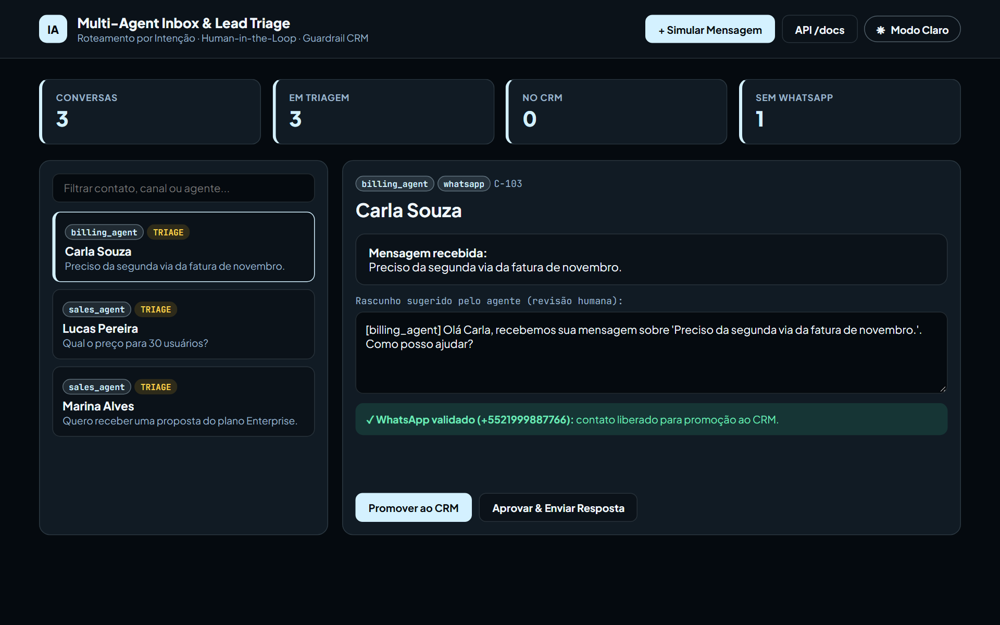
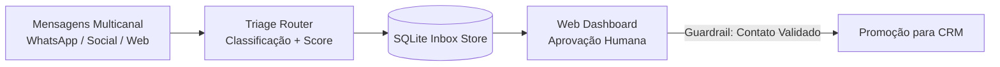

# Multi-Agent Inbox & Lead Triage Dashboard



Painel web full-stack em **FastAPI + SQLite + HTML/JS** para centralizar conversas de múltiplos canais (WhatsApp, LinkedIn Inbox, Chat Web), rotear atendimentos entre agentes especializados (Comercial, Suporte, Financeiro), simular novas entradas em tempo real e aplicar **guardrails de qualificação antes de promover um lead ao CRM** (ex.: exigir contato WhatsApp validado antes do envio ao funil comercial).

## Arquitetura



## Recursos

- **Roteamento Multi-Agente:** direciona conversas para o agente especialista adequado (`sales_agent`, `support_agent`, `billing_agent`) conforme intenção detectada.
- **Guardrail de Promoção ao CRM:** bloqueia o envio para o funil de vendas caso o contato ainda não possua telefone/WhatsApp validado, mantendo-o na fila de triagem.
- **Aprovação Humana (*Human-in-the-Loop*):** permite revisar a resposta sugerida pelo agente de IA, aprovar ou rejeitar pela interface web.
- **Seed de Demonstração:** inicia automaticamente com conversas fictícias para teste imediato em `http://127.0.0.1:8014`.

## Como Executar

```bash
pip install -r requirements.txt

# Inicia o painel web + API REST em http://127.0.0.1:8014
uvicorn app.main:app --port 8014 --reload

# Executa os testes automatizados
pytest -v
```
